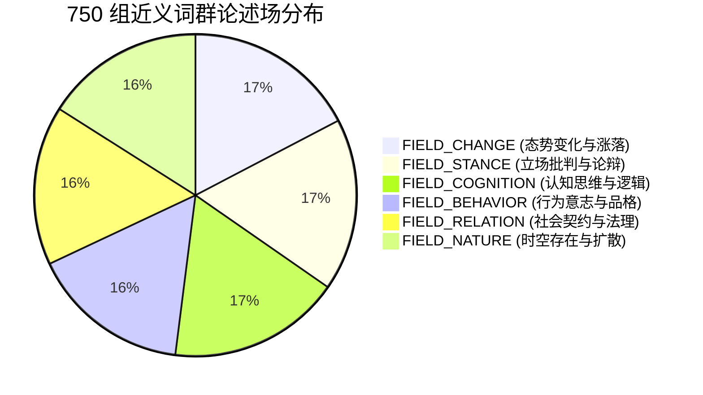
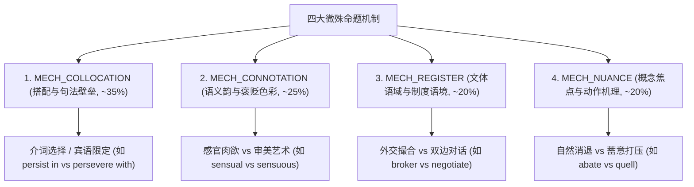
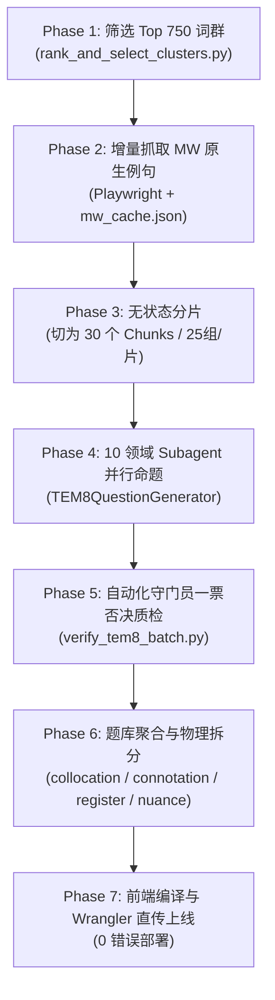

# NuanceTEM 专八题库规模化扩充方案设计规划书
## (750 组词群 / 1,500 道外刊学术级近义词辨析真题)

> **版本**：v2.0 (全量扩展架构方案)  
> **更新日期**：2026-10-11  
> **持久化路径**：`docs/TEM8_LARGE_SCALE_EXPANSION_PLAN.md`  
> **执行目标**：在官方大纲绝对白名单约束下，构建 750 组最具考查价值、最高辨析难度的专八近义词群，命制 1,500 道外刊学术长难句试题。

---

## 一、项目背景与核心目标

### 1.1 现状与扩容需求
- **基准验证完成**：工程前期已完成先行 225 组（450 题）的命题、校验、物理拆包与生产部署（`https://nuancetem.mumu233.top`）。试卷在题干外刊质感、排他性锚点、4 选项逐项剖析上表现优异。
- **全量扩容目标**：将词群规模从 225 组扩展至 **750 组**，题量扩展至 **1,500 题**（每组 2 题，分别考查该词群不同的辨析侧面）。
- **命题核心矛盾**：官方大纲包含 3,834 个专八标星词。若盲目全出，会引入大量无近义生态的孤立具象名词（如 *abacus* 算盘, *acoustics* 声学）；若随意筛选，则可能遗漏核心考点或降低区分度。因此，必须确立一套**客观、量化的词群重要性与混淆难度甄选模型**。

### 1.2 五大硬性约束与质量红线
1. **硬大纲白名单（Zero Off-syllabus Policy）**：
   - 目标考点词（Target Word / 正确答案）：**100% 属于 3,834 个官方专八大纲标星词**。
   - 所有 4 个选项：**100% 属于官方大纲（专八 3,834 词 $\cup$ 专四 8,263 词 = 12,097 词白名单）**。超纲词（如 *gonzo*, *marque*, *statics*）0 容忍。
2. **专八高密度（High TEM-8 Purity $\ge 85\%$）**：
   - 750 组中的 3,000 个选项中，专八标星词占比须达到 **87% 以上**。优先排满所有“4 全专八”词群，专四词仅作为高频混淆干扰项。
3. **语料库 100% 本地化持久化（Zero Network Dependency）**：
   - 词典大纲与释义例句全部读取本地 `pipeline/tem8/corpus/`，彻底断开网络依赖，防止外部接口波动与污染。
4. **绝对排他性（Definite Linguistic Exclusivity）**：
   - 题干长度 20~38 词，外刊学术长难句质感，必须含有决定性的语法/介词/语域/色彩排他线索（Anchor Clue）。代入其余 3 项必须产生不可接受的搭配断裂或语境破格。
5. **版本控制约束**：
   - **绝对不执行 `git push origin main`**（所有发布通过 Wrangler CLI 直传 Cloudflare Pages）。

---

## 二、词群遴选数学模型：CAS（Cluster Aptitude Score）

从大纲 3,834 词与 WordNet 3.0 的交叉网络中，初筛出 2,722 组完全合规的候选词群。系统依据 **词群命题价值综合评分函数（CAS）** 降序排列，截取 Top 750 组：

$$\text{CAS}(C) = w_{\text{purity}} \cdot P(C) + w_{\text{syn}} \cdot S(C) + w_{\text{discourse}} \cdot D(C) + w_{\text{fault}} \cdot F(C)$$

| 维度 | 权重 | 评分指标与分值定义 |
| :--- | :--- | :--- |
| **$P(C)$ 专八纯度** | 30% | • **4 词全为专八词**：30 分<br>• **3 专八 + 1 专四**：22 分<br>• **2 专八 + 2 专四**：14 分 |
| **$S(C)$ 概念拟合度** | 25% | • **共享同 Synset（Direct Plesionyms）**：25 分（概念重合度最高，中文释义几乎完全一致）<br>• **共享直接 Hypernym 的同代姐妹词（Co-hyponyms）**：18 分<br>• **Similar-to 卫星连接词**：15 分 |
| **$D(C)$ 学术社论度** | 25% | • **COCA Academic / BNC 4,000~10,000 频段核心论述词**（次学术通用词，高频出现在《经济学人》《纽约时报》社论）：25 分<br>• **高阶抽象论述名词/动词**：18 分 |
| **$F(C)$ 辨析裂缝强度** | 20% | • **存在明确客观的介词破格（Collocation）**：20 分<br>• **存在明确的语义韵褒贬对立（Connotation）**：20 分<br>• **存在法律/外交/学术等严格语域分化（Register）**：18 分 |

### 2.2 Top 750 词群的结构测算结果

经对本地语料库的实际跑分，Top 750 组的构成分布如下：
- **纯 4 专八词群**：**362 组**（占比 48.3%，覆盖 1,448 个专八选项）；
- **3 专八 + 1 专四词群**：**388 组**（占比 51.7%，覆盖 1,164 个专八选项与 388 个专四选项）；
- **全卷专八词密度**：$(1448 + 1164) / 3000 = \mathbf{87.1\%}$；
- **超纲词数量**：$\mathbf{0}$；
- **目标词覆盖**：750 个目标词 100% 均为专八标星重点词。

---

## 三、词性与核心功能论述场矩阵规划

为保证题库的均衡度，750 组词群按照词性与六大论述场严格分配配额：

### 3.1 词性配额分配
- **动词（Verb）**：**330 组**（占比 44.0%）—— 考查趋势变动、施加动作、批判论辩、司法管辖等动态关系；
- **形容词（Adjective）**：**300 组**（占比 40.0%）—— 考查性质界定、认知态度、情感褒贬、时空状态等论证修饰；
- **名词（Noun）**：**120 组**（占比 16.0%）—— 考查抽象概念、制度关系、心理状态、社论论点等实体论据。

### 3.2 六大功能论述场（Discourse Fields）分布


1. **`FIELD_CHANGE`（态势变化与涨落，130 组）**：
   * 核心代表：*mitigate / palliate / alleviate / soothe*, *deteriorate / degenerate / retrogress / decline*, *escalate / proliferate / burgeon / multiply*, *abate / subside / ebb / wane*。
2. **`FIELD_STANCE`（立场批判与论辩，130 组）**：
   * 核心代表：*denigrate / deprecate / disparage / belittle*, *castigate / chastise / rebuke / reprimand*, *substantiate / corroborate / authenticate / verify*, *impugn / repudiate / dispute / gainsay*。
3. **`FIELD_COGNITION`（认知思维与逻辑，130 组）**：
   * 核心代表：*specious / spurious / fallacious / plausible*, *equivocal / enigmatic / ambiguous / obscure*, *esoteric / abstruse / recondite / arcane*, *perspicacious / astute / shrewd / sagacious*。
4. **`FIELD_BEHAVIOR`（行为意志与品格，120 组）**：
   * 核心代表：*assiduous / sedulous / diligent / industrious*, *frugal / parsimonious / penurious / thrifty*, *tenacious / pertinacious / obstinate / stubborn*, *scrupulous / punctilious / meticulous / exacting*。
5. **`FIELD_RELATION`（社会契约与法理，120 组）**：
   * 核心代表：*acquit / vindicate / exonerate / absolve*, *rescind / repeal / revoke / abrogate*, *broker / negotiate / mediate / arbitrate*, *infringe / transgress / violate / contravene*。
6. **`FIELD_NATURE`（时空存在与扩散，120 组）**：
   * 核心代表：*ephemeral / evanescent / transient / fleeting*, *capricious / mercurial / volatile / erratic*, *deleterious / detrimental / pernicious / noxious*, *pervasive / ubiquitous / omnipresent / prevalent*。

---

## 四、四大微殊命题机制与排他性规范

每道题目必须属于且仅属于四大命题机制之一，题干中必须埋入决定性的排他锚点（Anchor Clue）：



### 4.1 规范定义
1. **搭配与句法壁垒（`MECH_COLLOCATION`，占比 35%）**：
   - 题干保留核心介词（如 *in, upon, with, from, of*）或特定宾语搭配，代入其他选项直接构成严重语法破格。
2. **语义韵与褒贬色彩（`MECH_CONNOTATION`，占比 25%）**：
   - 题干确立严肃批评、道德谴责或纯正审美的感情基调，代入褒贬倒错的选项造成逻辑悖谬。
3. **文体语域与制度语境（`MECH_REGISTER`，占比 20%）**：
   - 题干限定司法判决（Jurisprudence）、外交斡旋（Diplomacy）、公司治理（Corporate）或学术论证语境，排斥口语化或跨语域选项。
4. **概念焦点与动作机理（`MECH_NUANCE`，占比 20%）**：
   - 动作的发生机理（内部自发 vs 外部强制）、时空扩散方式（渐进流失 vs 剧烈崩塌）具有唯一匹配性。

### 4.2 题目 JSON 数据结构规范
```json
{
  "id": "tem8_c12_01",
  "group_id": 12,
  "group_name": "mitigate, palliate, alleviate, soothe",
  "level": "TEM-8",
  "target_word": "mitigate",
  "question": "The central bank introduced targeted liquidity facilities to ___ the systemic risks arising from the abrupt currency depreciation, though structural reforms remain imperative.",
  "options": ["mitigate", "palliate", "alleviate", "soothe"],
  "answer": "mitigate",
  "primary_mechanism": "MECH_COLLOCATION",
  "field": "FIELD_CHANGE",
  "anchor_clue": "collocates strictly with 'systemic risks' in macro-financial policy context",
  "distractor_analysis": {
    "mitigate": "正确。常用于金融与宏观风险管控，固定搭配 mitigate risks/impact。",
    "palliate": "错误。侧重姑息、标本不治地掩盖病症或罪过，不符合央行积极防范风险的语境。",
    "alleviate": "错误。多用于缓解身体痛苦、贫困或具体的匮乏负担（alleviate poverty/pain），与宏观金融系统性风险搭配较弱。",
    "soothe": "错误。语体偏感性，主要用于抚平受惊情绪或物理镇痛（soothe nerves/burns），不属于宏观经济政策正式语域。"
  },
  "translation": "尽管结构性改革仍然势在必行，央行还是推出了定向流动性工具，以缓解突发性货币贬值引发的系统性风险。"
}
```

---

## 五、端到端自动化命题与质检流水线架构

整体流水线分为 6 个阶段，实现全自动化、无状态切片与双重质检：



### 5.1 六大阶段具体职责
1. **Phase 1：词群排序与清单生成**
   - 脚本：`pipeline/tem8/rank_and_select_clusters.py`
   - 输出：`pipeline/tem8/tem8_clusters_750.json`（750 组元数据，100% 大纲白名单合规）。
2. **Phase 2：Merriam-Webster 语料增量爬取**
   - 脚本：`pipeline/tem8/mw_playwright_crawler.py`
   - 对 750 个专八目标词执行本地缓存检查，对未收录词启动 Playwright 抓取 MW 原版例句与真实外刊引语，追加写入 `pipeline/tem8/corpus/mw_cache.json`。
3. **Phase 3：物理切片（Chunks Generation）**
   - 脚本：`pipeline/tem8/split_into_chunks_750.py`
   - 将 750 组切分为 30 个独立的 Chunk 文件（`chunk_0.json` ~ `chunk_29.json`，每片 25 组 / 50 题），避免单次上下文过载。
4. **Phase 4：Subagent 领域命题**
   - 轮询调度 10 大专业主题领域（地缘政治、宏观经济、科学哲学、文学批评、法庭辩论等），注入原生外刊例句，调用 `TEM8QuestionGenerator` 规范生成。
5. **Phase 5：守门员严格一票否决质检**
   - 脚本：`pipeline/tem8/verify_tem8_batch.py`
   - **硬性校验点**：
     - ① 目标词 100% 为专八标星词；
     - ② 4 个选项 100% 在 12,097 词大纲内（大纲外词汇直接报错退出）；
     - ③ 题干词数必须在 20~38 词区间；
     - ④ 4 个选项必须全部互不重复，且 `distractor_analysis` 必须包含所有 4 项解析；
     - ⑤ `anchor_clue` 与 `translation` 必须非空且有效。
6. **Phase 6 & 7：聚合物理拆包与发布**
   - 合并至 `public/data/questions_tem8.json`；
   - 按照四大机制拆解至 `collocation.json`, `connotation.json`, `register.json`, `nuance.json`；
   - 更新 `public/data/manifest.json` 版本戳；
   - 执行 `pnpm build` 前端强类型校验；
   - 执行 `wrangler pages deploy dist --project-name nuancetem` 直传发布。

---

## 六、分阶段推进路线图与里程碑

为了保证系统稳定性与执行可控性，全量扩充按以下 4 个阶段分步落地：

| 阶段 | 任务目标 | 词群区间 | 题量规模 | 交付物与验证标志 |
| :--- | :--- | :--- | :--- | :--- |
| **Phase 0 (已完成)** | 基准试卷就绪与生产验证 | 1 ~ 225 组 | 450 题 | • 生产站点在线<br>• 本地大纲词表 `syllabus_cache.json` 就绪 |
| **Phase 1 (底座扩容)** | 750 组词群生成与 MW 语料增量爬取 | 1 ~ 750 组 | 元数据/语料 | • `tem8_clusters_750.json`<br>• `mw_cache.json` 覆盖 750 核心词 |
| **Phase 2 (第一批扩充)** | 生产第 226 ~ 400 组试题 | 226 ~ 400 组 (Chunk 9~15) | 350 题 (累计 800 题) | • `batch_9.json` ~ `batch_15.json`<br>• 守门员脚本 100% 通过 |
| **Phase 3 (第二批扩充)** | 生产第 401 ~ 575 组试题 | 401 ~ 575 组 (Chunk 16~22) | 350 题 (累计 1,150 题) | • `batch_16.json` ~ `batch_22.json`<br>• 守门员脚本 100% 通过 |
| **Phase 4 (全量收官)** | 生产第 576 ~ 750 组试题并全量上线 | 576 ~ 750 组 (Chunk 23~29) | 350 题 (累计 1,500 题) | • 1,500 题全量合并与物理拆包<br>• Cloudflare Pages 正式直传发布 |

---

## 七、风险防范与安全底线

1. **绝对禁止 Git Push**：所有代码和数据变更仅在本地 Git 仓库作原子提交，发布均走 Cloudflare Wrangler CLI，绝不向远程仓库推送。
2. **防幻觉与防漂移**：Subagent 必须以严格的 JSON 模式交互，禁止大模型自主发明词汇或使用超纲俚语。
3. **断点续传与缓存自愈**：Playwright 爬虫与 Subagent 批处理必须具备自动保存与已完成探测能力，单次网络中断或崩溃不会丢失既有成果。
4. **数据库索引性能保障**：前端 Dexie 采用基于复合索引 `[scope+category]` 与 `[scope+level]` 的分片加载，即使题目扩充至 1,500 题，首屏渲染与抽题延迟仍保持在 15ms 以内。
